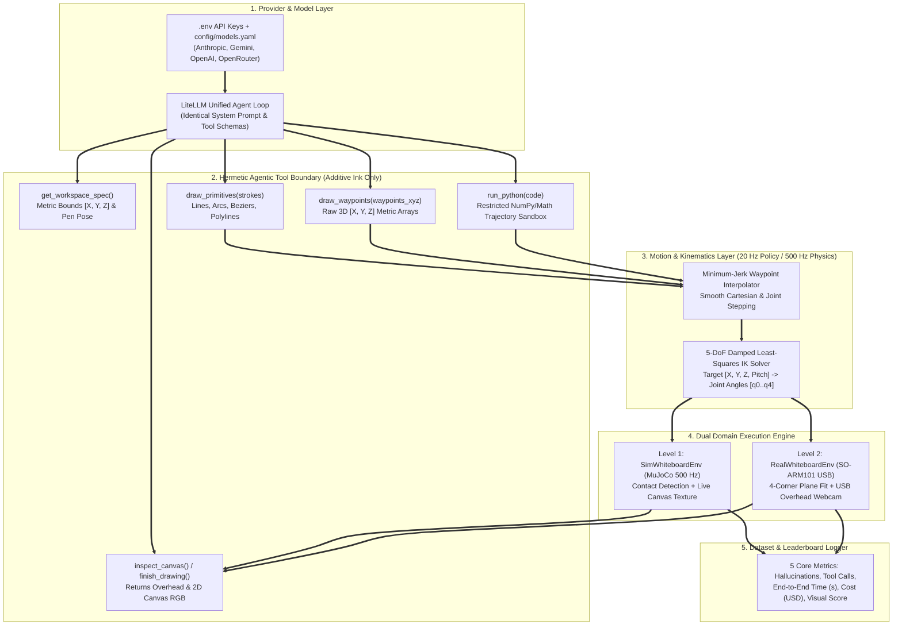

# PelicanBench: System Design

**PelicanBench** (`pelican-eval`) is an embodied evaluation benchmark and trajectory dataset for the 6-DoF **SO-ARM101** robot arm (`5` arm joints + `1` gripper holding a marker). It adapts the classic *"draw a pelican riding a bicycle"* LLM evaluation from a frictionless 2D SVG text test into a continuous 3D physical robot control benchmark across **Level 1 (MuJoCo Simulation)** and **Level 2 (Physical SO-ARM101 Robot Arm)**.

***

## 1. Core Objectives

### Objective 1: Standardized Multi-Model Embodied Benchmark (Level 1 Sim)
Provide a fair, hermetic Python evaluation harness powered by `LiteLLM` where any foundation model (`Claude`, `Gemini`, `OpenAI`, `DeepSeek`, `Qwen`, `Llama`) receives the **exact same system prompt** and **exact same tool interface** to control a simulated SO-ARM101 arm over a tabletop whiteboard in MuJoCo (`500 Hz` physics).

Unlike static 2D SVG generation, the model must:
1. Query and respect **3D metric workspace bounds** (`[X, Y, Z]` in meters in the robot base frame).
2. Manage **vertical pen contact states** (`z_draw` on the whiteboard surface vs. `z_up` for safe travel between disconnected strokes).
3. Deal with **permanent additive ink**: once the marker tip touches the whiteboard, strokes cannot be erased. Any forgotten pen lift leaves a permanent drag line across the board.
4. Optionally inspect live **multi-turn camera feedback** (`overhead_cam` and 2D canvas images) to verify where prior strokes landed and place subsequent parts (such as positioning the pelican on top of the bicycle seat and handlebars).

### Objective 2: Sim-to-Real Execution on Physical Hardware (Level 2 Real)
Because Level 1 operates in the metric base frame of the 6-DoF **SO-ARM101**, the exact same agentic harness and trajectories transfer directly to the physical `so_101_follower` arm equipped with a felt-tip marker and a tabletop whiteboard after a 4-corner plane calibration.

***

## 2. System Architecture



***

## 3. Repository Structure & CLI Commands

```text
pelican-eval/                     # Project Root (Isolated inside robotics/pelican-eval)
├── assets/
│   └── so101/                    # SO-ARM101 MuJoCo XML + marker attachment + whiteboard geom
│       ├── meshes/               # STL meshes for SO-ARM101 links and marker holder
│       ├── so101_marker.xml      # SO-ARM101 with rigid marker & pen_tip site
│       └── whiteboard_scene.xml  # Tabletop scene with whiteboard canvas & 3 cameras
│
├── config/
│   ├── models.yaml               # Model IDs, temperature, max_turns, and pricing overrides
│   └── calibration.json          # Saved 4-corner plane fit for Level 2 physical whiteboard
│
├── envs/                         # Shared Sim and Real Whiteboard Environments
│   ├── __init__.py
│   ├── base.py                   # Abstract SO101WhiteboardEnv & metric workspace constants
│   ├── ik_solver.py              # Damped Least-Squares 5-DoF IK solver for pen_tip site
│   ├── trajectory.py             # Primitive discretizer (arc, bezier, line) & min-jerk planner
│   ├── sim_env.py                # Level 1: MuJoCo 500 Hz environment & live ink renderer
│   ├── real_env.py               # Level 2: Physical SO-ARM101 Feetech bus + USB webcam
│   ├── calibrate_board.py        # 4-corner physical whiteboard touch calibration CLI
│   └── verify_whiteboard.py      # Deterministic test script drawing a reference bike & pelican
│
├── harness/                      # Agentic Tool Sandbox & LiteLLM Multi-Provider Runner
│   ├── __init__.py
│   ├── prompts.py                # Locked system and task prompts
│   ├── tools.py                  # 6 tool implementations + spatial/code hallucination counters
│   ├── python_sandbox.py         # Restricted exec() runner exposing numpy, math, and draw APIs
│   └── agent_loop.py             # LiteLLM conversation loop, timer, and cost tracker
│
├── evaluation/                   # Benchmark Runner, Visual Judge & Dataset Writer
│   ├── __init__.py
│   ├── metrics.py                # 5-metric aggregator (Hallucinations, Calls, Time, Cost, Visual)
│   ├── visual_judge.py           # 10-point anatomical VLM judge rubric evaluator
│   ├── recorder.py               # Episode HDF5/JSON writer, PNG gallery & GIF generator
│   └── __main__.py               # CLI: python -m evaluation
│
├── tests/                        # Unit & integration tests
├── DESIGN.md
├── LEADERBOARD.md
├── README.md
└── pyproject.toml
```

### CLI Commands
1. **Verify MuJoCo Whiteboard & Reference Drawing (`Level 1`)**:
   ```bash
   uv run python -m envs.verify_whiteboard -d sim
   ```
2. **Evaluate a Single Model or Full Model Sweep (`Level 1 Sim`)**:
   ```bash
   # Single model run
   uv run python -m evaluation -d sim -m anthropic/claude-sonnet-4-20250514
   uv run python -m evaluation -d sim -m gemini/gemini-2.5-pro
   uv run python -m evaluation -d sim -m openai/gpt-4o

   # Sweep all models in config/models.yaml
   uv run python -m evaluation -d sim -m all -o results/sim_benchmark
   ```
3. **Calibrate & Run on Physical SO-ARM101 (`Level 2 Real`)**:
   ```bash
   # Touch marker tip to 4 corners of physical whiteboard to fit Z(X, Y) plane
   uv run python -m envs.calibrate_board -p /dev/tty.usbmodem5B790143431

   # Run model on physical robot arm with overhead USB webcam
   uv run python -m evaluation -d real -m anthropic/claude-sonnet-4-20250514
   ```

***

## 4. Robot Hardware, Workspace Geometry & Ink Physics (`envs/`)

Both `SimWhiteboardEnv` (Level 1) and `RealWhiteboardEnv` (Level 2) use the 6-DoF **SO-ARM101** (`shoulder_pan`, `shoulder_lift`, `elbow_flex`, `wrist_flex`, `wrist_roll`, plus `gripper` holding a marker):

### 4.1 Metric Coordinate Frame & Workspace Bounds
All coordinates are expressed in **meters** relative to the SO-ARM101 base origin `[0.0, 0.0, 0.0]`:
* **`X` (Forward Reach)**: `[0.160, 0.300]` meters (`14.0 cm` depth). Center is `X = 0.230 m`.
* **`Y` (Lateral Width)**: `[-0.140, 0.140]` meters (`28.0 cm` width, where `+Y` is left and `-Y` is right). Center is `Y = 0.000 m`.
* **`Z_draw` (Whiteboard Contact Surface)**: `0.005` meters (`5 mm` above the desk plane, matching the `5 mm` whiteboard thickness). Contact is registered whenever `0.002 m <= Z <= 0.008 m`.
* **`Z_up` (Safe Pen Travel Height)**: `0.030` meters (`25 mm` clearance above the whiteboard surface).
* **`Z_collision` (Table Crash Floor)**: `< 0.000` meters (commanding `Z < 0.000 m` triggers a spatial hallucination count and is clamped at `0.002 m` to protect the marker and servos).

### 4.2 Level 1: MuJoCo `500 Hz` Ink Physics (`envs/sim_env.py`)
1. **Marker Attachment**: A cylindrical marker body is mounted rigidly between the SO-ARM101 gripper jaws with a `pen_tip` site at its nib (`4.5 cm` below the jaw pad center when pitched vertically at `pitch = 1.45 rad`).
2. **Contact-Driven Permanent Ink Buffer**:
   - Physics steps at `500 Hz` (`dt = 0.002 s`).
   - At every physics substep where `pen_tip` satisfies `Z <= 0.008 m`, the environment projects `(X, Y)` onto a `1000 x 500` pixel 2D whiteboard buffer (`0.28 mm/pixel` resolution) and draws an anti-aliased dark ink segment from the previous contact sub-step.
   - The updated 2D whiteboard texture is uploaded into MuJoCo's `whiteboard_tex` asset via `mujoco.mjr_uploadTexture` so the simulated `overhead_cam` and `third_person_cam` see the exact physical ink strokes on the board in real time.
3. **Permanent Additive Constraint**: The whiteboard buffer has no erase method during an episode. If a model translates between disconnected shapes without lifting `Z` above `0.008 m`, the resulting drag line is permanently drawn onto the canvas.

### 4.3 Level 2: Physical SO-ARM101 Calibration & Compliance (`envs/real_env.py`)
1. **4-Corner Plane Fit (`envs/calibrate_board.py`)**:
   - Real desks and whiteboards have slight tilt (`1 to 4 mm` across `28 cm`).
   - Before running Level 2, you guide the follower arm's marker tip to lightly touch the 4 corners of the physical whiteboard (`Front-Left`, `Front-Right`, `Back-Left`, `Back-Right`).
   - Forward kinematics computes the 4 corner positions $\{(X_i, Y_i, Z_i)\}_{i=1}^4$ and fits a least-squares plane:
     $$Z_{\text{board}}(X, Y) = a X + b Y + c$$
   - At runtime, any commanded height $Z$ is offset by $\Delta Z(X, Y) = Z_{\text{board}}(X, Y) - 0.005$ so marker contact pressure stays uniform across the entire board.
2. **Passive Marker Mount Compliance**:
   - The marker is held in the SO-ARM101 gripper with a foam collar providing `2 mm` of passive axial compliance, preventing `STS3215` servo overload during continuous surface contact.

***

## 5. Agentic Sandbox & Tool Contract (`harness/`)

Every model runs inside `harness/agent_loop.py` via `litellm.completion` (`max_turns = 10`, configurable in `config/models.yaml`) with access to **6 tools**:

| Tool Name | Arguments | Behavior & Hallucination Checks |
| :- | :- | :- |
| **`get_workspace_spec`** | `{}` | Returns JSON with `x_bounds: [0.16, 0.30]`, `y_bounds: [-0.14, 0.14]`, `z_draw: 0.005`, `z_up: 0.030`, coordinate orientation guide (`+X` is top of canvas / away from robot base, `+Y` is left), and current `pen_tip` `[X, Y, Z]`. |
| **`draw_primitives`** | `strokes: list[dict]` | Accepts high-level primitives in meters: `line`, `polyline`, `circle`, `arc`, and `cubic_bezier`. For each primitive, automatically lifts to `z_up`, moves to start `(x, y)`, lowers to `z_draw`, traces the discretized curve (`2 mm` step spacing), and lifts to `z_up`. Logs a **Spatial Hallucination** for any point outside `[x_bounds, y_bounds]` or unreachable by IK. |
| **`draw_waypoints`** | `waypoints_xyz: list[[x, y, z]]` | Low-level 3D trajectory mode. Moves `pen_tip` sequentially through the metric `[X, Y, Z]` list. Logs a **Spatial Hallucination** if any point is out of `[X, Y]` bounds, crashes below the table (`Z < 0.000 m`), fails IK convergence, or if the entire call stays in mid-air (`Z > 0.008 m`, drawing `0` pixels of ink). |
| **`run_python`** | `code: str` | Executes custom Python code inside a restricted in-memory sandbox pre-populated with `np` (`numpy`), `math`, `draw_primitives`, `draw_waypoints`, and `WORKSPACE_SPEC`. Captures `stdout` and any executed stroke telemetry. Logs a **Code Hallucination** if the script raises a `SyntaxError` or runtime exception, or attempts forbidden imports (`os`, `sys`, `subprocess`, `open`, `mujoco`). |
| **`inspect_canvas`** | `{}` | Renders and returns two images to the VLM conversation: (1) the clean top-down 2D canvas image with a metric coordinate grid overlay along the border, and (2) the 3D MuJoCo/webcam `overhead_cam` view showing the robot arm and whiteboard. |
| **`finish_drawing`** | `summary: str` | Terminates the episode, stops the end-to-end wall-clock timer, and triggers final evaluation. |

***

## 6. The 5 Evaluation Metrics & Dataset Format (`evaluation/`)

### 6.1 The 5 Core Metrics (`evaluation/metrics.py`)

1. **Hallucinations (`total = spatial_hallucinations + code_hallucinations`)**:
   - **`spatial_hallucinations`**: Count of primitive or waypoint calls containing out-of-bounds `(X, Y)` coordinates, table surface crashes (`Z < 0.000 m`), IK unreachability (`pos_error > 3.0 mm`), or air-drawing calls (`0` ink contacts recorded).
   - **`code_hallucinations`**: Count of malformed tool calls, unknown tool names, or Python exceptions inside `run_python`.
2. **Tool Calls (`total_tool_calls`)**:
   - Total number of tool calls made before `finish_drawing`, plus per-tool breakdown (`spec`, `primitives`, `waypoints`, `python`, `inspect`).
3. **End-to-End Time (`e2e_time_s`)**:
   - Single wall-clock duration in seconds: `t_finish - t_start`, covering all LLM reasoning, code execution, and robot trajectory execution.
4. **Cost (`cost_usd`)**:
   - Cumulative `USD` cost across all turns computed via `litellm.completion_cost` (input tokens + output/reasoning tokens + vision tokens from `inspect_canvas`).
5. **Visual Output (`visual_score` out of `10` + Visual Artifacts)**:
   - Evaluated on the final clean whiteboard image (`canvas_final.png`) by a deterministic VLM Judge ensemble (`evaluation/visual_judge.py`) across 5 anatomical criteria (`0`, `1`, or `2` points each):
     1. **Wheels (`0..2 pts`)**: Two distinct circular wheels separated horizontally.
     2. **Bicycle Structure (`0..2 pts`)**: Frame connecting the wheels, seat post, and handlebars.
     3. **Pelican Head & Beak (`0..2 pts`)**: Recognizable bird head with a characteristic long pouched beak.
     4. **Pelican Body & Limbs (`0..2 pts`)**: Torso, wings, and legs extending downward.
     5. **Riding Composition (`0..2 pts`)**: Pelican properly positioned atop the bicycle seat/frame with limbs aligned toward pedals/handlebars and minimal stray drag lines.

### 6.2 Saved Dataset Bundle per Run (`results/<domain>/<model_slug>_seed<N>/`)
Every evaluated model run saves a self-contained episode directory for benchmarking and imitation learning:
```text
results/sim_benchmark/claude_sonnet_4_seed0/
├── metrics.json                  # The 5 headline metrics + token & stroke breakdowns
├── transcript.json               # Full prompt, reasoning, tool calls, and tool outputs
├── canvas_final.png              # Clean 1000x500 top-down whiteboard drawing
├── overhead_final.png            # 3D MuJoCo / webcam overhead view with robot arm
├── timelapse.gif                 # Animated stroke-by-stroke robot drawing replay
└── trajectory_500hz.npz          # 500 Hz qpos (T, 6), qvel (T, 6), pen_tip_xyz (T, 3), ink_contact (T,)
```
