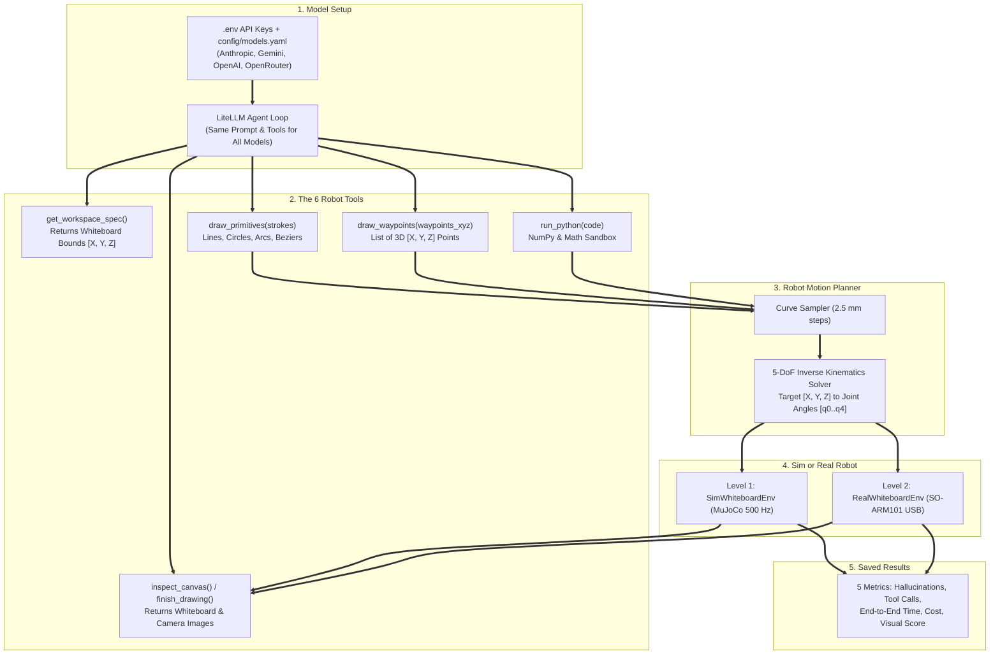

# PelicanBench: System Design

**PelicanBench** (`pelican-eval`) benchmarks AI models on controlling a 6-DoF **SO-ARM101** robot arm (`5` arm joints + `1` gripper holding a marker) to draw a **pelican riding a bicycle** on a tabletop whiteboard.

Instead of outputting a 2D SVG text file, the model must move a 3D robot arm in meters (`[X, Y, Z]`), lower the marker onto the board (`Z = 0.005 m`) to draw, and lift the marker (`Z = 0.030 m`) to travel between strokes without dragging ink across the board.

***

## 1. Core Goals

### Goal 1: Fair Comparison in MuJoCo Simulation (`Level 1: -d sim`)
Give every model (`Claude`, `Gemini`, `GPT`, `DeepSeek`, `Qwen`) the exact same system prompt and the same 6 tools via `LiteLLM`.
In a single run, the model must:
1. Check the whiteboard bounds (`[X, Y, Z]` in meters relative to the robot base).
2. Lower the marker to `z_draw = 0.005 m` to draw and lift to `z_up = 0.030 m` when moving between parts.
3. Work with **permanent ink**: once a line is drawn on the board, it cannot be erased.
4. Optionally call `inspect_canvas()` to view the camera image of what it has drawn so far and add missing parts before calling `finish_drawing()`.

### Goal 2: Run on the Physical SO-ARM101 Robot (`Level 2: -d real`)
Use the same 6-DoF **SO-ARM101** robot geometry and metric coordinates in both simulation and the real world. After touching the marker tip to the 4 corners of a physical whiteboard to measure desk tilt, the exact same harness runs on the real `so_101_follower` arm over USB.

***

## 2. How the System Works



***

## 3. Repository Layout & Commands

```text
pelican-eval/
├── assets/
│   ├── so101/                    # SO-ARM101 MuJoCo XML, STL meshes, marker, and whiteboard
│   │   ├── meshes/
│   │   ├── so101_marker.xml      # SO-ARM101 arm with marker and pen_tip site
│   │   └── whiteboard_scene.xml  # Desk, framed whiteboard, and cameras
│   └── verification/             # Reference pelican drawing images and GIF
│
├── config/
│   ├── models.yaml               # List of models and default turn/timeout settings
│   └── calibration.json          # 4-corner plane fit for the real whiteboard
│
├── envs/                         # Sim and Real Whiteboard Environments
│   ├── base.py                   # Shared SO101WhiteboardEnv interface and workspace bounds
│   ├── ik_solver.py              # 5-DoF Inverse Kinematics solver for pen_tip
│   ├── trajectory.py             # Converts lines, circles, arcs, and Beziers into 3D points
│   ├── sim_env.py                # Level 1: MuJoCo 500 Hz simulation and ink drawing
│   ├── real_env.py               # Level 2: Real SO-ARM101 USB servo driver + webcam
│   ├── calibrate_board.py        # 4-corner touch calibration script for the real board
│   └── verify_whiteboard.py      # Test script that draws a reference pelican on a bike
│
├── harness/                      # Agent Loop & Tool Sandbox
│   ├── prompts.py                # System and task prompts given to every model
│   ├── tools.py                  # The 6 tools and hallucination counters
│   ├── python_sandbox.py         # Safe exec() sandbox with numpy, math, and draw functions
│   └── agent_loop.py             # LiteLLM multi-turn loop, timer, and cost tracker
│
├── evaluation/                   # Scoring & Dataset Saving
│   ├── metrics.py                # Combines the 5 metrics and formats Markdown tables
│   ├── visual_judge.py           # Scores the final drawing from 0 to 10
│   ├── recorder.py               # Saves JSON logs, PNGs, GIF, and 500 Hz .npz trajectories
│   └── __main__.py               # CLI: python -m evaluation
│
├── tests/                        # Unit and integration tests
├── DESIGN.md
├── LEADERBOARD.md
├── README.md
└── pyproject.toml
```

### CLI Commands
```bash
# 1. Test the MuJoCo whiteboard with the reference drawing (no API key needed)
uv run python -m envs.verify_whiteboard -d sim

# 2. Evaluate a single model in MuJoCo Sim
uv run python -m evaluation -d sim -m anthropic/claude-sonnet-4-20250514
uv run python -m evaluation -d sim -m gemini/gemini-2.5-pro
uv run python -m evaluation -d sim -m openai/gpt-4o

# 3. Evaluate all models in config/models.yaml
uv run python -m evaluation -d sim -m all -o results/sim_benchmark

# 4. Calibrate and run on the physical SO-ARM101 arm
uv run python -m envs.calibrate_board -p /dev/tty.usbmodem5B790143431
uv run python -m evaluation -d real -p /dev/tty.usbmodem5B790143431 -m anthropic/claude-sonnet-4-20250514
```

***

## 4. Robot Workspace & First-Principles Math (`envs/`)

### 4.1 Whiteboard Coordinates (Meters from Robot Base `[0, 0, 0]`)
Both `SimWhiteboardEnv` and `RealWhiteboardEnv` use the same 3D coordinate system in **meters**:
* **`X` (Up / Down on the canvas)**: `0.160 m` (bottom edge, closest to robot base) to `0.300 m` (top edge, furthest from robot base). Total height is `14 cm`, centered at `X = 0.230 m`.
* **`Y` (Left / Right on the canvas)**: `+0.140 m` (left edge) to `-0.140 m` (right edge). Total width is `28 cm`, centered at `Y = 0.000 m`.
* **`Z_draw = 0.005 m`**: Whiteboard surface height. Whenever the marker tip is at `Z <= 0.008 m`, it leaves blue ink on the board.
* **`Z_up = 0.030 m`**: Safe travel height (`2.5 cm` above the board) to move between strokes without drawing ink.
* **`Z < 0.000 m`**: Table crash floor. Commanding `Z < 0.000 m` counts as a spatial hallucination and is clamped to `0.002 m`.

### 4.2 Inverse Kinematics (`envs/ik_solver.py`)
1. **What is it?**
   A math solver that takes a target 3D point `[X, Y, Z]` in meters for the marker tip and finds the joint angles `[q0, q1, q2, q3, q4]` in radians that put the marker tip at that exact point.
2. **Why do we use it?**
   Models think in 2D/3D space (circles for wheels, lines for the bike frame), while the robot motors only understand joint angles. Without a damped solver, points near the edge of the arm's reach can cause huge joint jumps.
3. **How do we use it?**
   At each `2.5 mm` step along a stroke, `SO101IKSolver` measures the 3D position error $\mathbf{e}$ between the target `[X, Y, Z]` and the current `pen_tip` position, and updates the joints using Damped Least-Squares:
   $$\Delta \mathbf{q} = \mathbf{J}^T (\mathbf{J} \mathbf{J}^T + \lambda^2 \mathbf{I})^{-1} \mathbf{e}$$
   Across the entire `14 cm x 28 cm` whiteboard, this keeps tracking error below `0.15 mm`.
4. **Where is it used in the real world?**
   Every industrial robot controller (FANUC, KUKA, Franka, Universal Robots) and simulation stack (MuJoCo, Drake, Isaac Lab) uses damped Jacobian IK to track smooth tool paths.

### 4.3 How Drawing Works in MuJoCo (`envs/sim_env.py`)
* The physics engine runs at **`500 Hz`** (`1` step every `2 ms`).
* At every `2 ms` physics step, `SimWhiteboardEnv` checks the 3D position of the `pen_tip` site at the end of the marker.
* If `Z <= 0.008 m`, it maps `(X, Y)` to a pixel `(row, col)` on a `1000 x 500` image buffer and draws a blue line from the previous contact point.
* It uploads that updated image buffer into MuJoCo's `whiteboard_tex` texture so the simulated `overhead_cam` and `third_person_cam` see the drawn ink live on the 3D whiteboard.

### 4.4 Real Whiteboard 4-Corner Calibration (`envs/calibrate_board.py`)
1. **What is it?**
   A one-time setup script that measures the exact tilt of your physical desk and whiteboard by having you touch the marker tip to the 4 corners of the board.
2. **Why do we use it?**
   Real desks are rarely flat to the millimeter. If one side of the whiteboard is `3 mm` higher than the other, a fixed height of `Z = 0.005 m` will press too hard on one side and float in the air (leaving no ink) on the other side.
3. **How do we use it?**
   Touching the 4 corners gives 4 3D points $\{(X_i, Y_i, Z_i)\}_{i=1}^4$. We fit a flat plane:
   $$Z_{\text{board}}(X, Y) = a X + b Y + c$$
   During real robot runs (`-d real`), `RealWhiteboardEnv` adds the height offset $\Delta Z(X, Y) = Z_{\text{board}}(X, Y) - 0.005$ to every waypoint so the marker presses evenly across the entire board.
4. **Where is it used in the real world?**
   3D printers (auto bed leveling), CNC routers, and PCB assembly robots all probe 3 or more points on the work surface to fit a tilt plane before starting a job.

***

## 5. The 6 Robot Tools (`harness/tools.py`)

Every model can call these 6 tools in any order (up to `max_turns = 10` turns):

| Tool | Input | What It Does & What Counts as a Hallucination |
| :- | :- | :- |
| **`get_workspace_spec`** | `{}` | Returns the whiteboard `[X, Y, Z]` bounds in meters, coordinate directions (`+X` is up, `+Y` is left), and current marker position. |
| **`draw_primitives`** | `strokes: list[dict]` | Draws 2D shapes in meters (`line`, `polyline`, `circle`, `arc`, `ellipse`, `bezier`). Automatically lifts to `z_up` before and after each shape. Logs a **Spatial Hallucination** if any point falls outside the board. |
| **`draw_waypoints`** | `waypoints_xyz: list[[x, y, z]]` | Moves the marker through an explicit list of 3D `[X, Y, Z]` coordinates. Logs a **Spatial Hallucination** if a point is out of bounds, hits the table (`Z < 0`), or stays in the air the whole time (`0` ink drawn). |
| **`run_python`** | `code: str` | Runs custom Python math using `np` (`numpy`), `math`, `WORKSPACE_SPEC`, `draw_primitives`, and `draw_waypoints`. Logs a **Code Hallucination** if the code has a syntax/runtime error or tries to import blocked modules (`os`, `sys`, `subprocess`, `open`). |
| **`inspect_canvas`** | `{}` | Moves the arm out of the way and returns 2 PNG images to the model: (1) the 2D whiteboard with metric `X/Y` rulers along the edges, and (2) the 3D overhead camera view. |
| **`finish_drawing`** | `summary: str` | Parks the arm at home, stops the timer, and scores the final drawing. |

***

## 6. Scoring & Saved Files (`evaluation/`)

### 6.1 The 5 Benchmark Metrics (`evaluation/metrics.py`)
1. **Hallucinations (`total = spatial + code`)**:
   - `spatial_hallucinations`: Out-of-bounds `(X, Y)` coordinates, table crashes (`Z < 0.0 m`), unreachable IK points, or air-drawing calls (`0` ink pixels).
   - `code_hallucinations`: Invalid tool names, bad JSON arguments, or Python exceptions inside `run_python`.
2. **Tool Calls**: Total number of tool calls made during the episode.
3. **End-to-End Time (`s`)**: Total wall-clock seconds from sending the prompt to `finish_drawing()`.
4. **Cost (`USD`)**: Total API token cost computed by `LiteLLM`.
5. **Visual Score (`0 to 10`)**: Graded across 5 parts (`0` to `2` points each):
   - **Wheels (`0..2`)**: Two separate circular wheels near the bottom of the board.
   - **Bicycle Frame (`0..2`)**: Frame connecting the wheels, seat, pedals, and handlebars.
   - **Pelican Head & Beak (`0..2`)**: Head and long pouched beak near the top.
   - **Pelican Body & Limbs (`0..2`)**: Body on the seat, wing reaching forward, and legs reaching down.
   - **Riding Composition (`0..2`)**: Pelican properly placed riding the bicycle.

### 6.2 Files Saved for Each Run (`results/<domain>/<model>_seed<N>/`)
```text
results/sim_benchmark/claude_sonnet_4_seed0/
├── metrics.json                  # The 5 metrics + token and tool call breakdown
├── transcript.json               # Full prompt, model replies, tool calls, and errors
├── canvas_final.png              # Clean 1000x500 whiteboard drawing
├── canvas_grid.png               # Whiteboard drawing with metric X/Y rulers
├── overhead_final.png            # 3D overhead camera view
├── third_person_final.png        # 3D side camera view showing the SO-ARM101 arm
├── timelapse.gif                 # Side-by-side animated GIF of the robot drawing
└── trajectory_500hz.npz          # 500 Hz joint positions, velocities, pen tip XYZ, and ink contact
```
